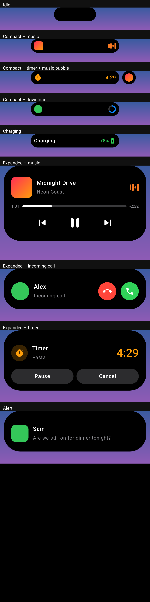

# Island Bar

An Android app that brings an iPhone-style "dynamic island" to the **Samsung Galaxy S25 Ultra**:
a black pill wrapped around the punch-hole camera that morphs with a springy animation
to show what's going on — music, calls, timers, downloads, charging and new notifications.

Built with Kotlin + Jetpack Compose. Min Android 11, targets Android 15 (One UI 7/8).

## What it does




| State | Looks like | Gestures |
|---|---|---|
| **Idle** | Small pill around the camera | Tap → little bounce |
| **Compact** | Pill widens: info left & right of the camera | Tap → open app · Long-press / swipe down → expand |
| **Expanded** | Big rounded card under the camera | Tap → open app · Swipe up / tap outside → collapse (auto after 10 s) |
| **Two activities** | Main pill + a detached circle on the right | Tap circle → swap · Long-press circle → expand it |
| **Pop-up alert** | Island expands with the sender, title and message | Tap → open · Swipe up → dismiss |

Live activities are picked up automatically from notifications:

- 🎵 **Media** (any app with a media session — Spotify, YouTube Music, Samsung Music…):
  album art + animated waveform tinted from the artwork; expanded view has seek bar and
  previous / play-pause / next.
- 📞 **Calls**: green call timer; expanded view has answer / decline / hang-up buttons
  (uses `CallStyle` intents, falls back to action titles in English and Indonesian).
- ⏱ **Timers & stopwatches**: any ongoing notification with a chronometer (e.g. Google Clock).
- 🧭 **Navigation**, ⬇️ **downloads/progress**, and Android 16 **Live Updates**.
- 🔋 **Charging**: brief "Charging 78%" when you plug in.
- 💬 **New notifications** briefly pop the island open (only interruptive ones — silent,
  low-importance and Do-Not-Disturb-filtered notifications are skipped).

Priority for the main pill: call › navigation › timer › media › progress › live update.

## Build

```bash
./gradlew assembleDebug        # app/build/outputs/apk/debug/app-debug.apk
./gradlew assembleRelease      # minified, ~small; signed with the debug key for sideloading
```

To re-render every island state into `app/build/island-states.png` (no device needed):
`./gradlew testDebugUnitTest`.

Or push to GitHub — the **Build APK** workflow uploads both APKs as an artifact.

Requires JDK 17+ and the Android SDK (platform 35). Android Studio works out of the box.

## Install on the S25 Ultra

1. `adb install app-release.apk` (or copy the APK to the phone and open it).
2. **Allow restricted settings** — One UI blocks accessibility/notification access for
   sideloaded apps. Open *Settings › Apps › Island Bar › ⋮ (top right) › Allow restricted settings*.
3. Open Island Bar and tap **Enable** on:
   - **Island overlay** → *Accessibility › Installed apps › Island Bar* → on.
   - **Notification access** → allow.
4. Use the **Try it** buttons to preview each state, and the **Size & position** sliders to
   line the pill up perfectly with your camera.

Tips for One UI:
- *Settings › Battery › Background usage limits*: make sure Island Bar is not in "Deep sleeping apps".
- If you've enabled *Display › Camera cutout › Hide*, the camera area is blacked out and the
  pill may need a larger height / vertical offset.
- At non-default screen resolutions (FHD+/QHD+) the pill auto-centres on the camera using the
  display-cutout API; sizes are in dp so they scale with *Screen zoom*.

## How it works

```
NotificationListenerService ──► IslandRepository (StateFlow) ──► Compose UI in an
   └─ MediaTracker (MediaController)        ▲                     accessibility overlay
AccessibilityService ── charging receiver ──┘                     window over the camera
```

- `service/IslandAccessibilityService` hosts a `TYPE_ACCESSIBILITY_OVERLAY` window
  (`overlay/IslandWindow`). Unlike a normal "draw over other apps" window, it can sit on
  top of the status bar and inside the camera cutout. It reads no screen content.
- The window is only as big as the pill (grows before an expansion, shrinks after the
  collapse settles), so touches elsewhere pass straight through to apps.
- `ui/island/Island.kt` is a small state machine (hidden / idle / compact / expanded /
  alert / charging) whose width, height and corner radius animate with an under-damped
  spring, while content cross-fades and scales in like iOS.
- `service/IslandNotificationListener` classifies notifications into live activities;
  `MediaTracker` follows media sessions for live metadata, playback state and controls.

## Notes & limitations

- Samsung's own Clock app may draw its timer with custom views; timers only show up when
  the app uses a standard chronometer notification.
- Opening apps from the island goes through the notification's `PendingIntent`; a few
  apps restrict background launches, in which case nothing happens on tap.
- Google Play restricts accessibility-service use; this project is intended for personal
  sideloading.
- "Dynamic Island" is an Apple trademark; this is an independent look-alike, not affiliated with Apple.
