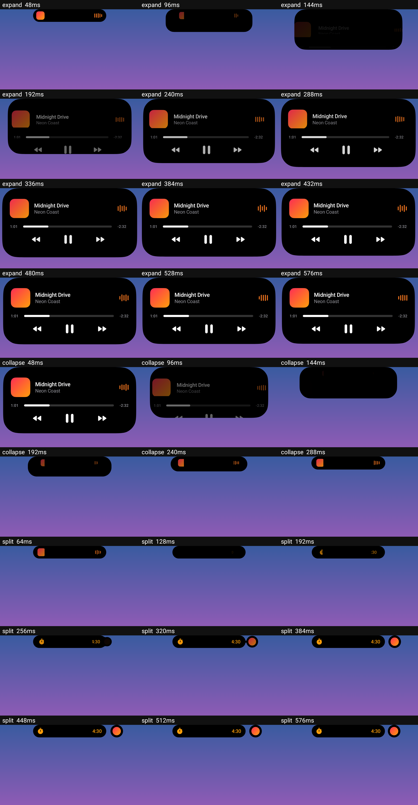
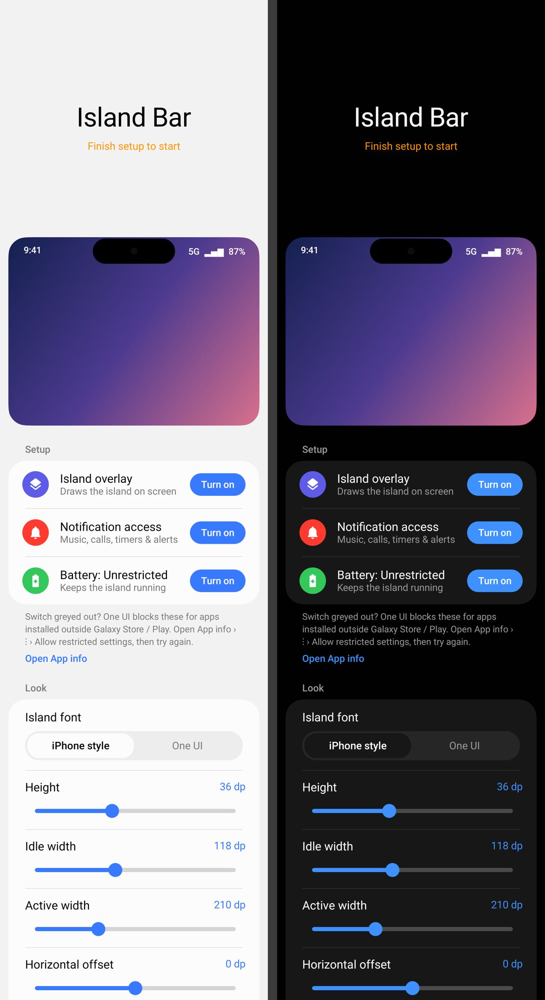

# Island Bar

An Android app that brings an iPhone-style "dynamic island" to the **Samsung Galaxy S25 Ultra**:
a black pill wrapped around the punch-hole camera that morphs with a springy animation
to show what's going on — music, calls, timers, downloads, charging and new notifications.

Built with Kotlin + Jetpack Compose. Min Android 11, targets Android 15 (One UI 7/8).

## What it does

 


| State | Looks like | Gestures |
|---|---|---|
| **Idle** | Small pill around the camera | Tap → little bounce · Swipe down → notification panel |
| **Compact** | Pill widens: info left & right of the camera | Tap → open app · Long-press / swipe down / S Pen hover → expand |
| **Expanded** | Big rounded card under the camera | Tap → open app · Swipe up / tap outside → collapse (auto after 10 s) |
| **Two activities** | Main pill + a detached circle on the right | Tap circle → swap · Long-press circle → expand it |
| **Pop-up alert** | Island expands with the sender, title and message | Tap → open · Swipe up → dismiss |

Live activities are picked up automatically from notifications:

- 🎵 **Media** (any app with a media session — Spotify, YouTube Music, Samsung Music…):
  album art + animated waveform tinted from the artwork; expanded view has seek bar and
  previous / play-pause / next.
- 📞 **Calls**: green call timer; expanded view has answer / decline / hang-up buttons
  (uses `CallStyle` intents, falls back to action titles in English and Indonesian).
- ⏱ **Timers & stopwatches**: any ongoing notification with a chronometer (e.g. Google Clock).
- 🧭 **Navigation**, ⬇️ **downloads/progress**, and Android 16 **Live Updates**.
- 🔋 **Charging**: brief "Charging 78%" when you plug in.
- 💬 **New notifications** briefly pop the island open (only interruptive ones — silent,
  low-importance and Do-Not-Disturb-filtered notifications are skipped).

Priority for the main pill: call › navigation › timer › media › progress › live update.

## Built for the Galaxy S25 Ultra / One UI



- **Status-bar aware.** Defaults (118 dp idle / 210 dp active at FHD+) leave One UI's clock and
  signal/Wi-Fi/battery icons visible; auto-centres on the punch-hole at any screen resolution.
- **Pull-down works through the island.** Swiping down on the idle island (or an expanded card)
  opens the notification panel, exactly like swiping the status bar.
- **Gets out of One UI's way.** The island melts into the camera while the notification panel /
  quick settings are open, and in full-screen videos and games (optional), like the status bar.
  This uses only the *type and position* of on-screen windows; no screen content is read.
- **Now Bar / Live notifications.** One UI 7+ live notifications (Samsung Clock timers,
  Samsung Health workouts, Voice Recorder, Smart Switch progress…) are picked up from Samsung's
  `android.ongoingActivityNoti.*` extras. These keys are undocumented, so support is best effort.
- **S Pen hover to peek.** Hover the S Pen over a live activity and it expands, like Air view;
  move the pen away and it folds back.
- **Battery: Unrestricted** setup step so One UI's "deep sleeping apps" can't stop the island.
- **One UI settings app.** Tall "reachability" header that collapses on scroll, system font
  (SamsungOne), follows light/dark mode, One UI cards, seek bars, switches and blue accents,
  plus One UI tips: hide status bar notification icons, set pop-ups to Brief to avoid duplicates.
- **Island font:** iPhone-style (Inter) or One UI's system font.

## Motion & design

- **Direction-aware springs.** Expanding uses a slightly softer, bouncier spring for the
  height than the width, so the island widens and then *drops* open with a gentle overshoot;
  collapsing uses tighter, near-critically-damped springs so it snaps back crisply.
  Springs keep their velocity when interrupted, so rapid state changes stay fluid.
- **Blur-morph content.** Each state's content fades in from a blur while scaling up from
  under the camera (Android 12+), and expanded layouts stagger in item by item.
- **Compact content glides out from the camera** to its left/right slots.
- **Gooey split.** A second activity buds off the pill as a liquid "metaball" bubble, stretches,
  snaps free and settles with a bounce; it melts back in when it ends.
- **Touch physics.** Pressing inflates the island slightly; dragging it rubber-bands; tapping
  the idle pill makes it wobble; buttons shrink under your finger.
- **Continuous ("squircle") corners** like Apple's, Inter typography with tabular digits,
  an organic noise-driven waveform tinted from the album art, and an iOS-style battery glyph.
- The settings screen opens with a **live preview phone** that loops through every state.

## Build

```bash
./gradlew assembleDebug        # app/build/outputs/apk/debug/app-debug.apk
./gradlew assembleRelease      # minified, ~small; signed with the debug key for sideloading
```

To re-render every island state and the animation filmstrips into `app/build/` (no device needed):
`./gradlew testDebugUnitTest`.

Or push to GitHub — the **Build APK** workflow uploads both APKs as an artifact.

Requires JDK 17+ and the Android SDK (platform 35). Android Studio works out of the box.

## Install on the S25 Ultra

1. `adb install app-release.apk` (or copy the APK to the phone and open it).
2. **Allow restricted settings** — One UI blocks accessibility/notification access for
   sideloaded apps. Open *Settings › Apps › Island Bar › ⋮ (top right) › Allow restricted settings*.
3. Open Island Bar and tap **Enable** on:
   - **Island overlay** → *Accessibility › Installed apps › Island Bar* → on.
   - **Notification access** → allow.
4. Use the **Try it** buttons to preview each state, and the **Size & position** sliders to
   line the pill up perfectly with your camera.

Tips for One UI (also linked from the app):
- Tap **Battery: Unrestricted** in the app, or check *Settings › Battery › Background usage limits*.
- *Notifications › Status bar › Show notification icons: None* keeps the left side clear.
- *Notifications › Notification pop-up style: Brief* (or off) avoids a pop-up next to the island's own alert.
- If you've enabled *Display › Camera cutout › Hide*, the camera area is blacked out and the
  pill may need a larger height / vertical offset.
- At non-default screen resolutions (FHD+/QHD+) the pill auto-centres on the camera using the
  display-cutout API; sizes are in dp so they scale with *Screen zoom*.

## How it works

```
NotificationListenerService ──► IslandRepository (StateFlow) ──► Compose UI in an
   └─ MediaTracker (MediaController)        ▲                     accessibility overlay
AccessibilityService ── charging receiver ──┘                     window over the camera
```

- `service/IslandAccessibilityService` hosts a `TYPE_ACCESSIBILITY_OVERLAY` window
  (`overlay/IslandWindow`). Unlike a normal "draw over other apps" window, it can sit on
  top of the status bar and inside the camera cutout. It reads no screen content.
- The window is only as big as the pill (grows before an expansion, shrinks after the
  collapse settles), so touches elsewhere pass straight through to apps.
- `ui/island/Island.kt` is a small state machine (hidden / idle / compact / expanded /
  alert / charging) whose width, height and corner radius animate with an under-damped
  spring, while content cross-fades and scales in like iOS.
- `service/IslandNotificationListener` classifies notifications into live activities;
  `MediaTracker` follows media sessions for live metadata, playback state and controls.

## Notes & limitations

- Samsung Clock timers come through One UI's live-notification extras, whose keys are undocumented.
  If a One UI update renames them, Clock timers fall back to not appearing.
- Full-screen detection infers "status bar hidden" from the window list; it only activates after
  the status bar has been seen once, so it can never hide the island permanently.
- Opening apps from the island goes through the notification's `PendingIntent`; a few
  apps restrict background launches, in which case nothing happens on tap.
- Google Play restricts accessibility-service use; this project is intended for personal
  sideloading.
- Bundles the [Inter](https://github.com/rsms/inter) typeface (SIL Open Font License, see `third_party/`).
- "Dynamic Island" is an Apple trademark; this is an independent look-alike, not affiliated with Apple.
